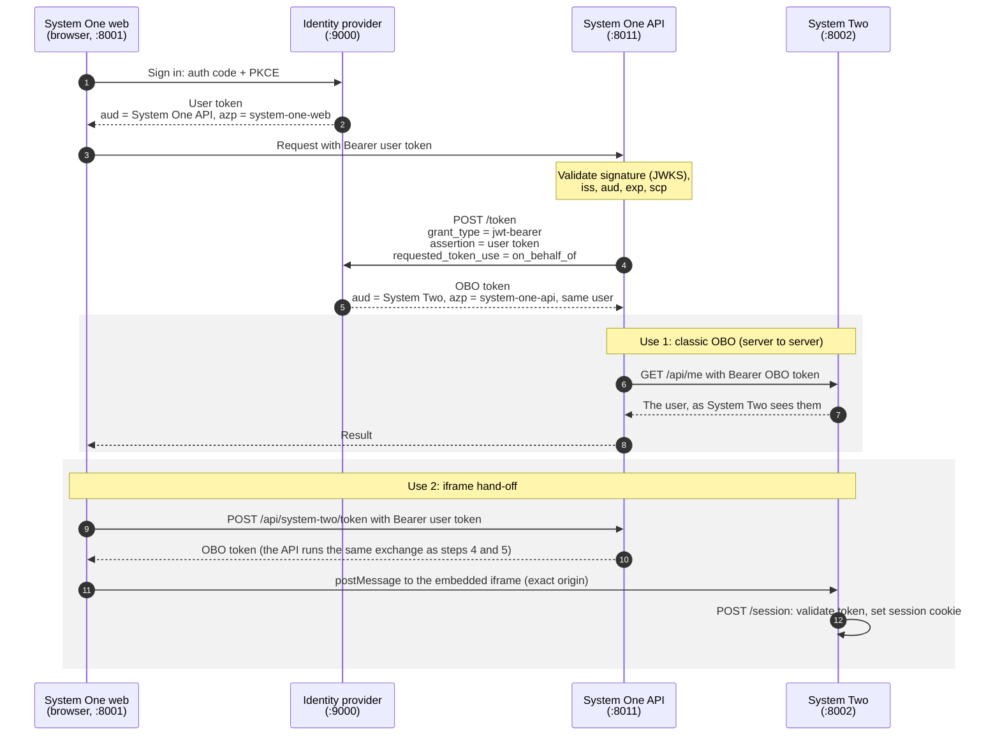

# OBO PoC: System One front end → System One API → (On-Behalf-Of) → System Two

A runnable proof of the Microsoft Entra **On-Behalf-Of (OBO)** flow. A backend API receives a user's token from a
front end, swaps it for a token to call another API as that same user, and the user signs in only once.

Everything runs on your machine, including the identity provider, so no Entra tenant, cloud account or Docker is
needed. The same code can later be pointed at a real Entra tenant by changing configuration only.

- [Get started from scratch](#get-started-from-scratch)
- [What you'll see](#what-youll-see)
- [Troubleshooting](#troubleshooting)
- [How it works](#how-it-works)
- [Tests](#tests)
- [Launch profiles and switching to Entra](#launch-profiles)

---

## Get started from scratch

### 1. Prerequisites

| You need | Version | Check with |
|----------|---------|------------|
| **Node.js** | 20 or newer | `node --version` |
| **uv** *or* **Python** | uv: any recent version; Python: 3.10 or newer | `uv --version` / `python --version` |
| Internet access | first setup only | – |

You **don't** need Java, Docker or admin rights. Setup downloads a private JDK and the local identity provider into
the project folder.

[uv](https://docs.astral.sh/uv/) is recommended because it fetches the right Python version itself. If you already
have Python 3.10+, that works too.

**Windows** (PowerShell):
```powershell
winget install OpenJS.NodeJS.LTS
winget install astral-sh.uv
```
Then **close and reopen your terminal** so the new commands are on your PATH.

**macOS** ([Homebrew](https://brew.sh)):
```bash
brew install node uv
```

**Linux:**
```bash
# Node.js 20+: from your package manager, https://nodejs.org or nvm
curl -LsSf https://astral.sh/uv/install.sh | sh
```

### 2. Get the code

Clone the repository, or unzip the folder you were given, then open a terminal in the `obo-poc` folder:

```bash
cd obo-poc
```

### 3. Install (one time)

```bash
npm install
npm run setup
```

`npm run setup` does four things, and is safe to re-run:
1. Creates a Python virtual environment in `.venv` (with uv if available, otherwise your Python).
2. Installs the Python packages from `requirements-dev.txt`.
3. Installs the Chromium browser Playwright uses for the tests.
4. Downloads a JDK and the local identity provider into `.tools/` (about 200 MB, a few minutes).

On **Linux**, Chromium may also need system libraries: `npx playwright install-deps chromium` (uses sudo).

### 4. Run it

```bash
npm start
```

Wait for `Profile "local" is up`, then open **http://localhost:8001** and follow [What you'll see](#what-youll-see).
Press **Ctrl+C** to stop everything.

### 5. Run the end-to-end tests

```bash
npm run test:e2e
```

This starts all the services itself (or reuses ones already running from `npm start`), signs in through a real
browser, and checks every step of the flow. Expect `10 passed`. Use `npm run test:e2e:headed` to watch the browser,
and `npx playwright show-report` for a step-by-step report.

---

## What you'll see

1. Opening http://localhost:8001 sends you to the local identity provider's **Mock OAuth2 Server Sign-in** page.
2. Type any username, for example `alice`. Optionally, in the claims box, enter `{"name": "Alice Example"}` to set a
   display name. Click **Sign-in**.
3. You're back on **System One**, which shows:
   - *Signed in as Alice Example (alice@contoso.test)*: System One's front end called **System One API** with your
     token.
   - *System Two API sees Alice Example, called by system-one-api on the user's behalf*: System One API used **OBO**
     to call **System Two's API** as you.
   - An embedded **System Two** page showing *Signed in as Alice Example, token issued to system-one-api on behalf
     of the user* and *System Two session active*. You never signed in to System Two.

To start again as a different user, click **Sign out of System One** or use a private browser window.

---

## Troubleshooting

| Problem | Fix |
|---------|-----|
| PowerShell: *running scripts is disabled on this system* when running `npm` | Use `npm.cmd` instead of `npm`, or run `Set-ExecutionPolicy -Scope CurrentUser RemoteSigned` once. |
| *uv* or *node* not recognised right after installing | Close and reopen the terminal. |
| *Python was not found; run without arguments to install from the Microsoft Store* | That's a Windows placeholder, not Python. Install uv (above) and re-run `npm run setup`. |
| *Address already in use*, or the wrong app appears on a port | Something else is using 9000, 8001, 8002 or 8011. Stop it, or change the ports in `env/local.env`. |
| Page shows old content or *undefined* | Your browser cached an older app from the same address. Hard-refresh with **Ctrl+Shift+R** (macOS **Cmd+Shift+R**). |
| Visiting http://localhost:9000 shows `{"detail":"Not Found"}` / 404 | Expected: the identity provider has no home page. Start from http://localhost:8001. |
| Setup can't download from GitHub / Maven Central (corporate proxy) | If you have Docker, run `docker compose up -d idp` instead. `npm start` and the tests reuse it. |

---

## How it works



The OBO token is used two ways:
1. **Classic OBO.** System One API calls System Two's API server-to-server.
2. **Iframe hand-off.** The token is posted into the embedded System Two page with `postMessage`, never in a URL.
   System Two checks it and starts its own session.

| Service              | Port | Code                                      | Registered as                                 |
|----------------------|------|-------------------------------------------|-----------------------------------------------|
| Identity provider    | 9000 | `idp/mock-oauth2-config.json`             | –                                             |
| System One front end | 8001 | `system_one_web/` (static SPA)            | public client (SPA), no secret                |
| System One API       | 8011 | `system_one_api/main.py`                  | confidential client; exposes `access_as_user` |
| System Two           | 8002 | `system_two/main.py`, `static/embed.html` | API; exposes `access_as_user`                 |

Stack: Python (FastAPI, PyJWT, httpx), plain HTML and JavaScript with no build step, Node.js for the launcher and
Playwright tests.

Shared token validation lives in `common/oidc.py`. Everything about the identity provider comes from environment
variables and from `{IDP_AUTHORITY}/.well-known/openid-configuration`, so switching provider needs no code changes.

### The local identity provider

The local profile uses NAV's [mock-oauth2-server](https://github.com/navikt/mock-oauth2-server) 6.1.3. NAV (the
Norwegian Labour and Welfare Administration) built it to test Azure AD / Entra OBO, so it accepts the same OBO
request Entra does. It's configured here to issue Entra v2-shaped tokens (`aud`, `scp`, `azp`, `oid`, `tid`,
`ver: 2.0`).

- **Without Docker (default):** `scripts/start-idp.mjs` uses [Coursier](https://get-coursier.io) to fetch a Temurin
  21 JDK and the server into `.tools/`, then runs it.
- **With Docker:** `docker compose up -d idp` runs the same version and config. The scripts detect it on port 9000
  and reuse it.

Mock limitations (Entra enforces these; the tests cover our side of the contract):
- The mock doesn't verify the OBO `assertion` or `requested_token_use`. It decides the token's audience by the
  calling `client_id`, standing in for Entra's app-registration permissions. System One API validates the user
  token before doing OBO, and `tests/test_obo_request.py` pins the exact OBO request to Entra's contract.
- Any username can sign in.

---

## Tests

| Command | What runs |
|---------|-----------|
| `npm run test:e2e` | Playwright, local profile |
| `npm run test:e2e:headed` | the same, with a visible browser |
| `npm run test:e2e:entra` | Playwright against a real Entra tenant (see below) |
| `.venv\Scripts\python -m pytest tests` (Windows) / `.venv/bin/python -m pytest tests` | unit tests for the OBO request |

`e2e/obo.spec.ts` signs in once through the identity provider's real UI, then checks:

- **Sign-in:** the SPA uses auth code + PKCE (S256), and the address bar is cleaned afterwards.
- **User token:** `aud` is System One API, `azp` is the SPA, and `scp` includes `access_as_user`.
- **OBO token:**
  - `aud` is System Two, not System One API.
  - `azp` is **System One API** (the middle tier), not the SPA.
  - Same `oid` and `tid` as the user, and the same issuer.
- **Classic OBO:** System One API → System Two API returns the user, called by System One API.
- **Iframe hand-off:** System Two signs the user in from the OBO token and sets its own httpOnly session cookie.
  The iframe URL contains no token.
- **One login:** the identity provider is visited exactly once.
- **Negative checks:**
  - System One API rejects missing tokens and OBO tokens, so an OBO token can't be replayed to mint more.
  - System Two rejects the user's System One token on both `/api/me` and `/session`.
  - System Two rejects tokens with a forged signature.
  - CSP `frame-ancestors` only allows System One to embed System Two.
  - System Two ignores `postMessage`s from anything but System One.

A screenshot of the final screen is saved to `test-results/obo-success.png`.

---

## Launch profiles

A profile is a file `env/<name>.env`. Real environment variables override file values, so secrets can come from
CI.

| Profile | File | Identity provider | Started locally | Commands |
|---------|------|-------------------|-----------------|----------|
| `local` | `env/local.env` (committed) | mock on :9000 | IdP + 3 apps | `npm start`, `npm run test:e2e` |
| `entra` | `env/entra.env` (gitignored, copy of `env/entra.env.example`) | your Entra tenant | 3 apps | `npm run start:entra`, `npm run test:e2e:entra` |

`scripts/profile.mjs` drives both the `npm start*` scripts and the Playwright configs (`playwright.config.ts`,
`playwright.entra.config.ts`). To run one app by hand on Windows:
`$env:ENV_FILE="env/local.env"; .venv\Scripts\python -m uvicorn system_one_api.main:app --port 8011`.

### Switching to Entra

1. **App registrations** in one tenant:
   - **System Two:**
     - *Expose an API*: App ID URI `api://<client-id>`, scope `access_as_user`.
     - *Manifest*: `"requestedAccessTokenVersion": 2`.
   - **System One API:**
     - *Expose an API*: scope `access_as_user`.
     - *Certificates & secrets*: a client secret.
     - *API permissions*: System Two `access_as_user` (delegated). **Grant admin consent**, because OBO can't show a
       consent prompt.
     - *Manifest*: `"requestedAccessTokenVersion": 2`.
     - Optionally list System One Web under *Authorized client applications*.
   - **System One Web:**
     - *Authentication*: platform **Single-page application**, redirect URI `http://localhost:8001/`.
     - *API permissions*: System One API `access_as_user` (delegated, admin-consented).
2. **Profile file:** copy `env/entra.env.example` to `env/entra.env` and fill in the IDs. Use a tenant-specific
   authority, `https://login.microsoftonline.com/<tenant-id>/v2.0`, not `/common`, whose issuer is a template.
3. **Secrets:** set `S1_API_CLIENT_SECRET` and `E2E_PASSWORD` in the file or as environment variables. The test
   user must not get MFA or Conditional Access prompts.
4. **Run:** `npm run test:e2e:entra`. The spec is the same; only the login helper in `e2e/support.ts` switches to
   Microsoft's sign-in page.

What changes with Entra:
- `aud` is the API's client ID GUID, and the profile's `*_AUDIENCES` lists both forms.
- `sub` is pairwise per app, which is why the apps and tests use `oid` as the cross-app user ID.
- OBO tokens live about 60 to 90 minutes, not 5.

Verified so far: `common/oidc.py` reads discovery and signing keys from real Entra, and Entra's discovery document
allows the SPA's cross-origin fetch. **Not yet verified:** a full `test:e2e:entra` run against a tenant, including
the Microsoft sign-in page selectors.

---

## Not production-ready, on purpose

- The SPA keeps its token in `sessionStorage`. MSAL.js would add silent renewal.
- OBO results aren't cached. Production should cache per user and scope until expiry, as MSAL's
  `acquire_token_on_behalf_of` does.
- Sessions are in memory.
- Cross-site production deployments need `SameSite=None; Secure` cookies for the iframe.
- The local identity provider is a test double: any username signs in.

## Project layout

```text
obo-poc/
  common/oidc.py            shared discovery + token validation
  system_one_web/           front end (SPA): static/index.html, static/app.js
  system_one_api/main.py    validates the user token, does OBO, calls System Two
  system_two/               embeddable page + API: main.py, static/embed.html
  idp/                      local identity provider config
  env/                      launch profiles (local.env, entra.env.example)
  scripts/                  setup, launcher, IdP starter (Node.js)
  e2e/                      Playwright tests
  tests/                    Python unit tests
  docker-compose.yml        optional: run the identity provider in Docker
```

If you share this as a zip, leave out `.venv/`, `node_modules/`, `.tools/`, `test-results/`,
`playwright-report/` and `env/entra.env`. Recipients recreate them with the steps above.
